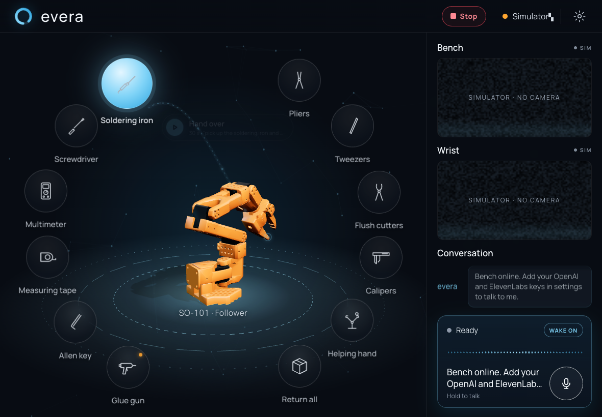

# Evera workshop vision

This repository contains a Limelight 3A live view, a CNN instance segmentation
pipeline, and an SO-101 setup script. The vision model is intended to produce
separate masks for Raspberry Pi boards, Arduino boards, Pinecil soldering irons,
and individual wires. Training and inference run on an AMD NucBox; the camera
feeds images to that computer over USB networking.

See [the vision guide](vision/README.md) for the current dataset, camera setup,
training commands, and accuracy limits. Images and weights are kept out of
Git. A separate held-out Limelight test set is still needed before any reliable
accuracy or autonomous arm claim.

See [the architecture](docs/ARCHITECTURE.md) and [the SO-101 setup guide](docs/SETUP.md).

## Robot demonstrations and policy training

[`robot/`](robot/README.md) records SO-101 teleoperation datasets on the NucBox through a browser
dashboard (Limelight top camera + wrist camera). [`training/`](training/README.md) trains an ACT
policy on AMD Radeon Cloud. Current state and next steps are in [docs/HANDOFF.md](docs/HANDOFF.md).

## evera iPad app

[`evera/`](evera/README.md) is a JARVIS-style iPad web app: tap a tool or say "evera, pass me the
multimeter" and the arm runs that action through the dashboard's `/api/policy`. It shows a live 3D
SO-101 built from the URDF, the camera feeds, and a STOP button. `robot/dashboard.py` serves it at `/evera/`.

