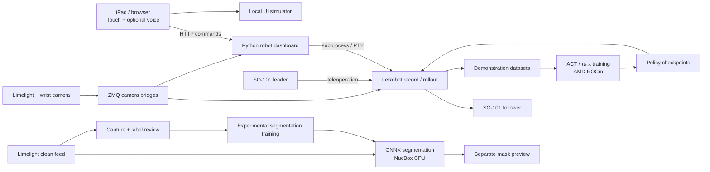

# Evera

**A robotics workbench prototype combining imitation learning, an iPad interface, and CPU vision.**

Evera explores a practical question: can a small robot arm assist with repetitive workbench tasks while a person stays focused on assembly? Built for the UCSC AI Hackathon's AMD Physical AI track, it connects SO-101 demonstration recording, learned policy execution, and a touch/voice interface. A separate vision workflow develops instance segmentation for tools and electronics.

**Start here:** [Try the simulator](#try-it-without-hardware) · [Architecture](docs/ARCHITECTURE.md) · [Hardware setup](docs/SETUP.md) · [Engineering audit](docs/REPOSITORY_AUDIT.md)


*Repository screenshot of the interface. The 3D arm is a scripted visualization, not live joint telemetry or evidence of task success.*

## What is implemented?

| Component | Implemented behavior | Evidence boundary |
|---|---|---|
| Recording and control | Two camera bridges, teleoperation recording, episode review, checkpoint launch, software stop | Requires calibrated arms, cameras, LeRobot, and the bench environment |
| iPad interface | Touch controls, simulator, URDF-based 3D view, optional speech and language APIs | Tool choices are interface modes, not independently trained skills; most use the default checkpoint |
| ACT policy workflow | Behavioral cloning, offline reward-weighted fine-tuning, recorded-action evaluation | Offline action error is not a physical task success rate |
| π₀.₅ vision-language-action (VLA) model | Fine-tuning, checkpoint checks, rollout scripts for AMD hardware | Experimental; general instruction-following on this bench is not established |
| Vision | YOLO11n-seg ONNX decoding on CPU, live masks, capture, labeling and training dashboard | Provisional model; reviewed held-out accuracy and vision-to-arm control remain incomplete |

The tracked repository contains code and an interface screenshot. Model weights, recordings, and datasets are external; a fresh clone cannot reproduce the hardware demonstration by itself. Historical measurements and their caveats remain in [training](training/README.md), [π₀.₅](pi05/README.md), and [vision](vision/README.md).

The VLA work lives in [`pi05/`](pi05/README.md): fine-tuning, checkpoint evaluation, and real-time chunked rollout. Unlike ACT, π₀.₅ consumes the task instruction as well as camera observations. The historical handoff records a local smoke-test checkpoint and cloud fine-tuning runs; the latest retained checkpoint and physical task results need verification on the training machine.

## Architecture



Vision does not currently choose grasp points or drive the robot. The policy runner uses camera observations directly. The interface animation reflects application state rather than measured arm position.

## Try it without hardware

Requires Python 3; no npm install, model download, API key, or build step:

```bash
git clone https://github.com/quantumcompiler32/evera.git
cd evera
python3 -m http.server 8765 --bind 127.0.0.1 --directory evera
```

Open **http://localhost:8765/?sim=1**. Select a tool and a mode to explore the animated workflow; use STOP or Escape to stop the simulated run. This demonstrates the interface only. Optional cloud voice features require credentials and internet access; touch simulation does not.

## Run with hardware

The bench configuration uses an SO-101 leader/follower pair, Limelight 3A, wrist USB camera, and AMD NucBox. GPU training uses PyTorch/ROCm on the NucBox or Radeon Cloud; segmentation inference uses NumPy, OpenCV, and ONNX Runtime on CPU.

1. Follow [setup](docs/SETUP.md) for the environment, serial ports, calibration, deployment paths, and camera bridges. It records the team's environment, not a portable lockfile.
2. Use the [robot dashboard](robot/README.md) to record and review demonstrations.
3. Train and evaluate [ACT](training/README.md) or the experimental [π₀.₅ pipeline](pi05/README.md).
4. Configure checkpoint paths in [`evera/actions.js`](evera/actions.js), then open `http://<GMKTEC_IP>:8080/evera/`.
5. Use the separate [vision dashboard](vision_dashboard/README.md) for capture and labeling. Validate on a different recording session before relying on predictions.

The robot dashboard has no authentication and can move physical hardware. Use a trusted isolated network; do not expose it publicly. Software STOP depends on the process and network and is not a physical emergency stop. Browser voice keys are stored locally; use a dedicated demo profile and clear keys before sharing it.

## Repository guide

| Directory | Responsibility |
|---|---|
| [`evera/`](evera/README.md) | Build-free JavaScript interface; three.js, URDF and STL assets |
| [`robot/`](robot/README.md) | Camera transport, recording, episode review, hardware dashboard |
| [`training/`](training/README.md) | ACT training, offline fine-tuning and evaluation |
| [`pi05/`](pi05/README.md) | Experimental vision-language-action policy workflow |
| [`vision/`](vision/README.md) | CPU segmentation inference and model/data conversion |
| [`vision_training/`](vision_training/README.md) | Frame selection and mask proposal tools |
| [`vision_dashboard/`](vision_dashboard/README.md) | Local capture, annotation and provisional training UI |
| [`scripts/`](scripts) | Setup, calibration and offline validation helpers |
| [`tests/`](tests) | Hardware-free regression checks |
| [`docs/`](docs/README.md) | Setup, architecture, historical evidence and research |

Deployment paths are retained so the existing bench scripts continue to work. Research baselines are labeled rather than deleted.

## Engineering decisions and limitations

- **Shared camera transport:** ZMQ bridges let recording and preview subscribe without competing for USB devices. Camera placement and image settings still have to match the training data.
- **Separate compute workloads:** CPU ONNX inference leaves the GPU available for robot policies. Training dependencies stay outside the inference module.
- **Policy versus language:** ACT imitates a fixed task and ignores task text. Selecting a different tool name does not turn that checkpoint into a new skill.
- **Data quality before metrics:** SAM outlines and guided auto-accepted masks are proposals. Whole-session splits and human-reviewed labels are needed to assess generalization; the dashboard still mixes in historical provisional data.
- **Prototype deployment:** Hardware paths and checkpoint locations are bench-specific. There is no full dependency lock, authenticated deployment, or demonstrated arbitrary-object manipulation.

Next priorities are reviewed held-out evaluation, reproducible target-machine environments, validated checkpoints per action, and camera-to-robot calibration before any vision-guided manipulation. See the [audit](docs/REPOSITORY_AUDIT.md) for remaining code and verification gaps.

## Development and verification

Requires Python 3.12+ and Node.js 22+ for the offline checks:

```bash
python3 scripts/check_repository.py
```

This checks Python, shell and JavaScript syntax and runs regression tests without touching hardware or downloading models. It does not validate GPU support, recognition accuracy, physical motion, or cloud voice services. See [CONTRIBUTING.md](CONTRIBUTING.md).

## Credits and licensing

Built as a team hackathon project; this repository does not assign individual ownership of every component. See [event context](docs/HACKATHON.md).

LeRobot provides recording and policy implementations; the SO-101 URDF/meshes come from TheRobotStudio/SO-ARM100; three.js powers the interface; Ultralytics and SAM support segmentation experiments. See [third-party notices](THIRD_PARTY_NOTICES.md). No project-wide license has been selected; upstream licenses do not automatically license this repository's original code.
